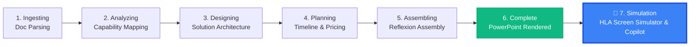
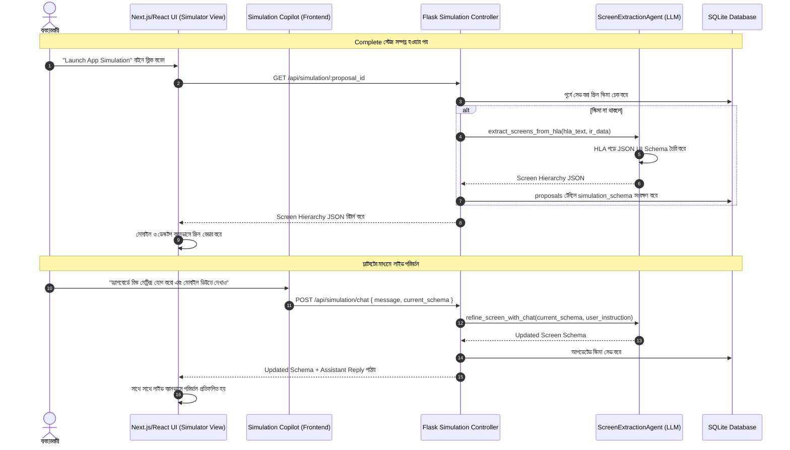

# HLA-ভিত্তিক স্ক্রিন সিমুলেশন স্টেজ ইমপ্লিমেন্টেশন প্ল্যান
*(HLA-Powered Screen Simulator & Copilot Architecture Plan)*

---

## ১. ভূমিকা ও উদ্দেশ্য (Overview & Objective)

বর্তমানে প্রপোজাল জেনারেশন পাইপলাইনের ৬টি স্টেজ রয়েছে:
> **Ingesting** → **Analyzing** → **Designing** → **Planning** → **Assembling** → **Complete** (Render PowerPoint)

এই আর্কিটেকচারাল প্ল্যানের মূল উদ্দেশ্য হলো **`Complete` স্টেজের পর একটি ৭ম স্টেজ — `Simulation` (বা App & Screen Simulator) যুক্ত করা**।

### মূল কার্যকারিতা:
1. **স্বয়ংক্রিয় স্ক্রিন শনাক্তকরণ (HLA Parsing)**: আপলোডকৃত High-Level Architecture (HLA) ডকুমেন্ট ও সলিউশন আর্কিটেকচার বিশ্লেষণ করে অ্যাপ্লিকেশনটির প্রয়োজনীয় স্ক্রিনসমূহ (যেমন: Login, Executive Dashboard, Role-based Workflow, Analytics) এবং প্ল্যাটফর্ম (Web, iOS, Android, Tablet) স্বয়ংক্রিয়ভাবে অনুমান করা।
2. **ইন্টারেক্টিভ চ্যাটবট কোপাইলট (Simulation Copilot)**: ব্যবহারকারী চ্যাটবটকে নির্দেশ দিয়ে নতুন স্ক্রিন তৈরি, কম্পোনেন্ট সংযোজন বা ফিল্ড পরিবর্তন করতে পারবেন (যেমন: *"অ্যাপ্রুভাল স্ক্রিনে টু-ফ্যাক্টর অথেনটিকেশন যোগ করো"* বা *"মোবাইল ভিউতে চার্টটি দেখাও"*)।
3. **মাল্টি-ডিভাইস লাইভ সিমুলেটর (Responsive Multi-Device Canvas)**: তৈরি হওয়া স্ক্রিনগুলো মোবাইল (iPhone 15), ট্যাবলেট (iPad Pro), এবং ডেস্কটপ রেজোলিউশনে একই সাথে লাইভ ইন্টারেক্টিভভাবে প্রিভিউ করা যাবে।

---

## ২. সিস্টেম আর্কিটেকচার ও ওয়ার্কফ্লো (System Architecture)

### ২.১ পাইপলাইন স্টেজ ট্রানজিশন



### ২.২ এন্ড-টু-এন্ড ডেটা ফ্লো



---

## ৩. ডেটা মডেল ও স্কিমা স্পেসিফিকেশন (Data Models)

### ৩.১ ডেটাবেস স্কিমা আপডেট (`new_agent_1_BE`)
SQLite `proposals` টেবিলে নতুন কলাম যুক্ত হবে:
```sql
ALTER TABLE proposals ADD COLUMN simulation_schema TEXT DEFAULT NULL;
```

### ৩.২ স্ক্রিন JSON স্কিমা স্পেসিফিকেশন (`ScreenSchema.json`)
```json
{
  "application_name": "Virtual Program Manager (VPM)",
  "target_platforms": ["web", "mobile_ios", "mobile_android"],
  "theme": {
    "primary": "#0ea5e9",
    "mode": "dark",
    "borderRadius": "12px"
  },
  "screens": [
    {
      "id": "screen_dashboard",
      "name": "Executive Dashboard",
      "category": "core",
      "description": "প্রজেক্ট হেলথ, বাজেট এবং মাইলস্টোন ট্র্যাকিং ওভারভিউ",
      "supported_devices": ["desktop", "tablet", "mobile"],
      "components": [
        {
          "type": "stats_grid",
          "props": {
            "title": "Core KPI Overview",
            "items": ["Active Sprints: 4", "Budget Burn: 68%", "Critical Blockers: 2"]
          }
        },
        {
          "type": "timeline_chart",
          "props": {
            "title": "Milestone Velocity",
            "stages": ["Q1 MVP", "Q2 Beta", "Q3 Production"]
          }
        },
        {
          "type": "action_table",
          "props": {
            "title": "Pending Governance Approvals",
            "columns": ["Item", "Requested By", "Status", "Action"],
            "rows": [
              { "item": "Vendor SOW Deviation", "by": "PMO Lead", "status": "Pending", "action": "Review" }
            ]
          }
        }
      ]
    },
    {
      "id": "screen_approval_flow",
      "name": "Human-in-the-Loop Review Screen",
      "category": "workflow",
      "description": "সিইও / প্রোগ্রাম ম্যানেজারের সিঙ্গেল-ট্যাপ অ্যাপ্রুভাল ইন্টারফেস",
      "supported_devices": ["mobile", "desktop"],
      "components": [
        {
          "type": "action_card",
          "props": {
            "title": "Decision Required: Architecture RFC #42",
            "description": "Vendor SOW Budget Deviation +$45,000 for React Frontend contractor.",
            "actions": ["Approve", "Request Changes", "Reject"]
          }
        }
      ]
    }
  ]
}
```

---

## ৪. ব্যাকএন্ড ইমপ্লিমেন্টেশন গাইড (`new_agent_1_BE`)

### ফাইল ১: `agents/simulation_agent.py`
```python
import json
from utils.llm_client import query_llm, safe_json_loads

SIMULATION_SYS_PROMPT = """
You are a Principal Enterprise Solutions Architect and Lead UX Designer.
Analyze the provided High-Level Architecture (HLA) document and solution specifications.
Identify what target applications (Web Portal, Native Mobile App, Admin Console, etc.) and what exact screens are required for this business system.

Generate a comprehensive UI Screen Hierarchy with realistic components, mock data, and user actions.
Strictly return JSON matching this schema:
{
  "application_name": string,
  "target_platforms": ["web", "mobile", "tablet"],
  "theme": { "primaryColor": string, "mode": "dark" },
  "screens": [
    {
      "id": string,
      "name": string,
      "category": "auth|core|workflow|analytics|settings",
      "description": string,
      "supported_devices": ["mobile", "tablet", "desktop"],
      "components": [
        {
          "type": "stats_grid|action_card|table|timeline_chart|form",
          "props": { ... }
        }
      ]
    }
  ]
}
"""

def extract_screens_from_hla(hla_text, ir_data=None):
    """HLA ডক থেকে স্ক্রিন হায়ারার্কি জেনারেট করে"""
    user_prompt = f"""
HLA Document / Architecture Content:
{hla_text[:6000]}

Intermediate Representation (Scope / Modules):
{json.dumps(ir_data)[:2000] if ir_data else "None"}

Generate the complete interactive screen specification.
"""
    res = query_llm(SIMULATION_SYS_PROMPT, user_prompt, temperature=0.4, max_tokens=3500)
    return safe_json_loads(res, {"application_name": "Enterprise System", "screens": []})

def refine_screen_with_chat(current_schema, user_instruction):
    """ইউজারের চ্যাটবট ইনপুটের ভিত্তিতে স্ক্রিন স্কিমা লাইভ মডিফাই করে"""
    refine_prompt = f"""
Current Screen Schema:
{json.dumps(current_schema, indent=2)}

User Instruction:
"{user_instruction}"

Update the screen schema to fulfill the user instruction. Keep the JSON strictly valid and return ONLY the JSON.
"""
    res = query_llm("You are a dynamic UI schema editor. Output valid JSON only.", refine_prompt, temperature=0.3)
    return safe_json_loads(res, current_schema)
```

---

### ফাইল ২: `controllers/simulation_controller.py`
```python
import json
from flask import request
from utils.api_response import success_response, error_response
from database.db_connection import get_db_connection
from agents.simulation_agent import extract_screens_from_hla, refine_screen_with_chat

def get_or_generate_screens(proposal_id):
    conn = get_db_connection()
    cursor = conn.cursor()
    
    cursor.execute("SELECT simulation_schema, requirements_text, files_info FROM proposals WHERE id = ?", (proposal_id,))
    row = cursor.fetchone()
    if not row:
        return error_response("Proposal not found", 404)
        
    sim_schema, req_text, files_info = row[0], row[1], row[2]
    
    # পূর্বের জেনারেট করা স্কিমা থাকলে রিটার্ন করবে
    if sim_schema:
        try:
            return success_response(json.loads(sim_schema))
        except Exception:
            pass
            
    # নতুন জেনারেট করা
    extracted_schema = extract_screens_from_hla(req_text or "Default Architecture Scope")
    
    cursor.execute("UPDATE proposals SET simulation_schema = ? WHERE id = ?", (json.dumps(extracted_schema), proposal_id))
    conn.commit()
    return success_response(extracted_schema)

def chat_simulation_refine():
    data = request.get_json()
    proposal_id = data.get('proposal_id')
    user_message = data.get('message')
    current_schema = data.get('current_schema')
    
    if not proposal_id or not user_message:
        return error_response("Proposal ID and message are required", 400)
        
    updated_schema = refine_screen_with_chat(current_schema, user_message)
    
    # ডেটাবেস আপডেট
    conn = get_db_connection()
    cursor = conn.cursor()
    cursor.execute("UPDATE proposals SET simulation_schema = ? WHERE id = ?", (json.dumps(updated_schema), proposal_id))
    conn.commit()
    
    return success_response({
        "reply": "আপনার রিকোয়ারমেন্ট অনুযায়ী স্ক্রিন আপডেট করা হয়েছে।",
        "updated_schema": updated_schema
    })
```

---

### ফাইল ৩: `app.py` তে রাউট ইন্টিগ্রেশন
```python
# app.py তে যুক্ত করতে হবে:
from controllers import simulation_controller

@app.route('/api/simulation/<proposal_id>', methods=['GET'])
def get_simulation_screens(proposal_id):
    return simulation_controller.get_or_generate_screens(proposal_id)

@app.route('/api/simulation/chat', methods=['POST'])
def chat_simulation():
    return simulation_controller.chat_simulation_refine()
```

---

## ৫. ফ্রন্টএন্ড ইমপ্লিমেন্টেশন গাইড (`new_agent_1_FE`)

### ফাইল ১: `STEP_PHASES` আপডেট (`Home.tsx`)
```tsx
import { Smartphone } from 'lucide-react';

const STEP_PHASES = [
  { name: 'Ingesting', label: 'Document parsing', icon: <FileUp size={16} /> },
  { name: 'Analyzing', label: 'Capability mapping', icon: <Cpu size={16} /> },
  { name: 'Designing', label: 'Solution architecture', icon: <Layers size={16} /> },
  { name: 'Planning', label: 'Timeline & pricing', icon: <Clock size={16} /> },
  { name: 'Assembling', label: 'Reflexion assembly', icon: <CheckCircle2 size={16} /> },
  { name: 'Complete', label: 'Render PowerPoint', icon: <Download size={16} /> },
  { name: 'Simulation', label: 'App & Screen Simulator', icon: <Smartphone size={16} /> },
];
```

---

### ফাইল ২: `SimulationModal.tsx` (কোপাইলট চ্যাট ও মাল্টি-ডিভাইস ভিউয়ার)
```tsx
import React, { useState, useEffect } from 'react';
import { Smartphone, Monitor, Send, Sparkles, Check, RefreshCw } from 'lucide-react';
import { DynamicScreenRenderer } from './DynamicScreenRenderer';

interface SimulationModalProps {
  proposalId: string;
  isOpen: boolean;
  onClose: () => void;
}

export const SimulationModal: React.FC<SimulationModalProps> = ({ proposalId, isOpen, onClose }) => {
  const [schema, setSchema] = useState<any>(null);
  const [activeScreenId, setActiveScreenId] = useState<string>('');
  const [messages, setMessages] = useState<Array<{ role: 'user' | 'assistant'; text: string }>>([
    { role: 'assistant', text: 'হ্যালো! HLA ডকুমেন্ট বিশ্লেষণ করে স্ক্রিনগুলো প্রস্তুত করা হয়েছে। আপনি স্ক্রিন সিলেক্ট করতে পারেন বা পরিবর্তনের নির্দেশ দিতে পারেন।' }
  ]);
  const [inputMsg, setInputMsg] = useState('');
  const [loading, setLoading] = useState(false);
  const [deviceFilter, setDeviceFilter] = useState<'all' | 'mobile' | 'desktop'>('all');

  useEffect(() => {
    if (isOpen && proposalId) {
      fetch(`/api/simulation/${proposalId}`)
        .then(res => res.json())
        .then(data => {
          if (data.data) {
            setSchema(data.data);
            if (data.data.screens?.length > 0) {
              setActiveScreenId(data.data.screens[0].id);
            }
          }
        });
    }
  }, [isOpen, proposalId]);

  const handleSendMessage = async () => {
    if (!inputMsg.trim() || loading) return;
    const userText = inputMsg;
    setInputMsg('');
    setMessages(prev => [...prev, { role: 'user', text: userText }]);
    setLoading(true);

    try {
      const res = await fetch('/api/simulation/chat', {
        method: 'POST',
        headers: { 'Content-Type': 'application/json' },
        body: JSON.stringify({
          proposal_id: proposalId,
          message: userText,
          current_schema: schema,
        })
      });
      const data = await res.json();
      if (data.data?.updated_schema) {
        setSchema(data.data.updated_schema);
        setMessages(prev => [...prev, { role: 'assistant', text: data.data.reply }]);
      }
    } finally {
      setLoading(false);
    }
  };

  if (!isOpen) return null;
  const activeScreen = schema?.screens?.find((s: any) => s.id === activeScreenId);

  return (
    <div className="fixed inset-0 z-50 bg-black/80 backdrop-blur-md flex items-center justify-center p-4">
      <div className="bg-slate-900 border border-slate-800 rounded-2xl w-full h-[92vh] flex flex-col overflow-hidden shadow-2xl">
        
        {/* Header */}
        <div className="flex items-center justify-between px-6 py-3 border-b border-slate-800 bg-slate-950">
          <div className="flex items-center gap-3">
            <div className="p-2 rounded-lg bg-blue-500/20 text-blue-400">
              <Sparkles size={18} />
            </div>
            <div>
              <h2 className="text-sm font-bold text-slate-100 flex items-center gap-2">
                {schema?.application_name || 'Application Simulator'}
                <span className="text-[10px] px-2 py-0.5 rounded-full bg-emerald-500/20 text-emerald-400 font-semibold">HLA Powered</span>
              </h2>
              <p className="text-xs text-slate-400">Screen Mockup & Multi-device Live Simulator</p>
            </div>
          </div>
          
          <div className="flex items-center gap-3">
            <div className="flex bg-slate-800 p-1 rounded-lg text-xs">
              <button onClick={() => setDeviceFilter('all')} className={`px-3 py-1 rounded ${deviceFilter === 'all' ? 'bg-blue-600 text-white' : 'text-slate-400'}`}>All Viewports</button>
              <button onClick={() => setDeviceFilter('mobile')} className={`px-3 py-1 rounded ${deviceFilter === 'mobile' ? 'bg-blue-600 text-white' : 'text-slate-400'}`}>Mobile Only</button>
              <button onClick={() => setDeviceFilter('desktop')} className={`px-3 py-1 rounded ${deviceFilter === 'desktop' ? 'bg-blue-600 text-white' : 'text-slate-400'}`}>Desktop Only</button>
            </div>
            <button onClick={onClose} className="p-1 text-slate-400 hover:text-white font-bold text-lg">✕</button>
          </div>
        </div>

        {/* Body Split */}
        <div className="flex-1 flex overflow-hidden">
          {/* Left: Chatbot & Screen list */}
          <div className="w-96 border-r border-slate-800 bg-slate-950 flex flex-col justify-between">
            <div className="p-3 border-b border-slate-800">
              <span className="text-[11px] font-semibold text-slate-400 uppercase tracking-wider block mb-2">
                HLA স্ক্রিনসমূহ ({schema?.screens?.length || 0})
              </span>
              <div className="flex flex-wrap gap-1.5 max-h-32 overflow-y-auto">
                {schema?.screens?.map((scr: any) => (
                  <button
                    key={scr.id}
                    onClick={() => setActiveScreenId(scr.id)}
                    className={`text-xs px-2.5 py-1.5 rounded-md text-left transition flex items-center justify-between gap-2 ${
                      activeScreenId === scr.id 
                        ? 'bg-blue-600 text-white font-medium' 
                        : 'bg-slate-800/60 hover:bg-slate-800 text-slate-300'
                    }`}
                  >
                    <span>{scr.name}</span>
                    {activeScreenId === scr.id && <Check size={12} />}
                  </button>
                ))}
              </div>
            </div>

            <div className="flex-1 p-3 overflow-y-auto space-y-3 text-xs">
              {messages.map((m, idx) => (
                <div key={idx} className={`flex ${m.role === 'user' ? 'justify-end' : 'justify-start'}`}>
                  <div className={`p-2.5 rounded-xl max-w-[85%] ${
                    m.role === 'user' 
                      ? 'bg-blue-600 text-white rounded-br-none' 
                      : 'bg-slate-800 text-slate-200 border border-slate-700 rounded-bl-none'
                  }`}>
                    {m.text}
                  </div>
                </div>
              ))}
              {loading && <div className="text-xs text-blue-400 animate-pulse">স্ক্রিন আপডেট হচ্ছে...</div>}
            </div>

            <div className="p-3 border-t border-slate-800 bg-slate-900/50">
              <div className="flex gap-2">
                <input
                  type="text"
                  value={inputMsg}
                  onChange={(e) => setInputMsg(e.target.value)}
                  onKeyDown={(e) => e.key === 'Enter' && handleSendMessage()}
                  placeholder="যেমন: ড্যাশবোর্ডে ফিল্টার অপশন যোগ করো..."
                  className="flex-1 bg-slate-950 border border-slate-700 rounded-lg px-3 py-2 text-xs text-slate-200 focus:outline-none focus:border-blue-500"
                />
                <button
                  onClick={handleSendMessage}
                  disabled={loading}
                  className="p-2 bg-blue-600 hover:bg-blue-500 rounded-lg text-white disabled:opacity-50"
                >
                  <Send size={14} />
                </button>
              </div>
            </div>
          </div>

          {/* Right: Multi-Device Viewports */}
          <div className="flex-1 bg-slate-900/80 p-6 overflow-auto flex items-start justify-center gap-8">
            {activeScreen ? (
              <>
                {(deviceFilter === 'all' || deviceFilter === 'mobile') && (
                  <div className="flex flex-col items-center">
                    <span className="text-xs text-slate-400 mb-2 flex items-center gap-1">
                      <Smartphone size={13} /> Mobile View (393 × 852)
                    </span>
                    <div className="w-[375px] h-[720px] bg-slate-950 border-4 border-slate-800 rounded-[38px] p-3 shadow-2xl overflow-y-auto">
                      <div className="w-24 h-4 bg-slate-800 rounded-full mx-auto mb-3" />
                      <DynamicScreenRenderer screen={activeScreen} platform="mobile" />
                    </div>
                  </div>
                )}

                {(deviceFilter === 'all' || deviceFilter === 'desktop') && (
                  <div className="flex flex-col items-center flex-1 max-w-[850px]">
                    <span className="text-xs text-slate-400 mb-2 flex items-center gap-1">
                      <Monitor size={13} /> Web Desktop View
                    </span>
                    <div className="w-full h-[720px] bg-slate-950 border border-slate-800 rounded-xl shadow-2xl overflow-y-auto flex flex-col">
                      <div className="bg-slate-900 px-4 py-2 border-b border-slate-800 flex items-center gap-2 text-xs text-slate-400">
                        <span className="w-2.5 h-2.5 rounded-full bg-red-500" />
                        <span className="w-2.5 h-2.5 rounded-full bg-amber-500" />
                        <span className="w-2.5 h-2.5 rounded-full bg-emerald-500" />
                        <span className="ml-4 bg-slate-950 px-4 py-0.5 rounded text-[11px] text-slate-500 flex-1">
                          https://vpm.internal/{activeScreen.id}
                        </span>
                      </div>
                      <div className="p-4 flex-1">
                        <DynamicScreenRenderer screen={activeScreen} platform="web" />
                      </div>
                    </div>
                  </div>
                )}
              </>
            ) : (
              <div className="text-slate-500 text-sm py-20">কোনো স্ক্রিন সিলেক্ট করা নেই।</div>
            )}
          </div>
        </div>

      </div>
    </div>
  );
};
```

---

### ফাইল ৩: `DynamicScreenRenderer.tsx` (উপাদান রেন্ডারার)
```tsx
import React from 'react';

export const DynamicScreenRenderer: React.FC<{ screen: any; platform: 'mobile' | 'web' }> = ({ screen, platform }) => {
  return (
    <div className="space-y-4 text-slate-200 font-sans">
      <div className="border-b border-slate-800 pb-3">
        <h3 className="text-base font-bold text-white">{screen.name}</h3>
        <p className="text-xs text-slate-400 mt-0.5">{screen.description}</p>
      </div>

      <div className="space-y-3">
        {screen.components?.map((comp: any, idx: number) => {
          if (comp.type === 'stats_grid') {
            return (
              <div key={idx} className={`grid gap-2 ${platform === 'mobile' ? 'grid-cols-2' : 'grid-cols-3'}`}>
                {comp.props.items?.map((item: string, i: number) => (
                  <div key={i} className="bg-slate-900 border border-slate-800 p-2.5 rounded-lg text-xs">
                    <span className="text-slate-400 text-[10px] block">Metric</span>
                    <span className="font-bold text-blue-400 text-sm">{item}</span>
                  </div>
                ))}
              </div>
            );
          }

          if (comp.type === 'action_card') {
            return (
              <div key={idx} className="bg-slate-900/90 border border-slate-800 p-3 rounded-xl space-y-2">
                <span className="text-xs font-semibold text-white block">{comp.props.title}</span>
                <p className="text-[11px] text-slate-400">{comp.props.description}</p>
                <div className="flex gap-2 pt-1">
                  {comp.props.actions?.map((act: string, aIdx: number) => (
                    <button
                      key={aIdx}
                      className="px-3 py-1 bg-blue-600 hover:bg-blue-500 text-white rounded text-xs font-medium"
                    >
                      {act}
                    </button>
                  ))}
                </div>
              </div>
            );
          }

          return (
            <div key={idx} className="p-3 bg-slate-900 border border-dashed border-slate-800 rounded-lg text-xs text-slate-400">
              {comp.props?.title || `${comp.type} component`}
            </div>
          );
        })}
      </div>
    </div>
  );
};
```

---

## ৬. ইমপ্লিমেন্টেশন রোডম্যাপ ও চেকলিস্ট (Execution Checklist)

| ফেজ | সময়কাল | প্রধান কাজ (Milestones) | ডেলিভারেবলস |
| :--- | :--- | :--- | :--- |
| **Phase 1: DB & Agents** | দিন ১-২ | SQLite টেবিলে `simulation_schema` যোগ করা এবং `simulation_agent.py` তৈরি করা | HLA থেকে স্বয়ংক্রিয় স্ক্রিন JSON জেনারেশন |
| **Phase 2: Controller & APIs**| দিন ৩ | `/api/simulation/:id` এবং `/api/simulation/chat` এন্ডপয়েন্ট তৈরি করা | চ্যাটবট দিয়ে স্ক্রিন পরিবর্তন API |
| **Phase 3: Frontend Stepper** | দিন ৪ | `STEP_PHASES` এ `Simulation` যুক্ত করা এবং `Complete` হলে বাটন প্রদর্শন | স্টেজ ট্রানজিশন ইউআই |
| **Phase 4: Simulator Canvas** | দিন ৫-৬ | `SimulationModal.tsx` এবং মাল্টি-ডিভাইস ভিউপোর্ট (Mobile/Desktop) রেন্ডারার | লাইভ রেসপনসিভ ভিউয়ার |
| **Phase 5: Copilot Integration** | দিন ৭ | চ্যাটবট লুপ ও রিয়েল-টাইম ক্যানভাস স্টেট সিঙ্কিং | ইন্টারেক্টিভ সিমুলেশন অভিজ্ঞতা |
